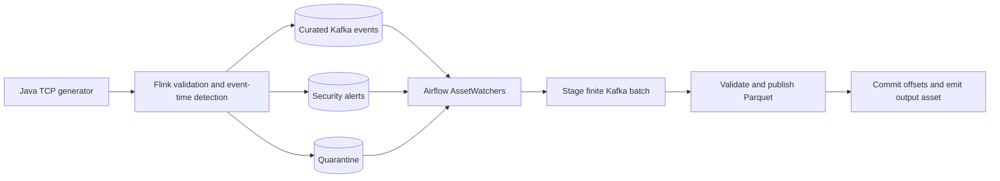

# Kafka, Flink and Airflow event pipeline

Java generates synthetic Windows events over TCP. Flink validates and classifies
those events, detects failed-login bursts, and writes curated events, alerts and
quarantine records to Kafka. Airflow **3.3.2** watches Kafka availability and
processes finite batches into **Parquet files on a shared local volume**.

This combines the original `mwaa-kafka-project` and
`tcp_flink_kafka_connector` sources. Only this checkout is required. Everything
runs locally with Podman and Astro CLI; no cloud account is required.



## Start

```bash
git clone https://github.com/vikramaditya-tatke/kafka-flink-airflow-pipeline.git
cd kafka-flink-airflow-pipeline
systemctl --user start podman.socket
./scripts/pipeline.sh up
./scripts/pipeline.sh status
./scripts/pipeline.sh verify
```

Install Podman, a Compose provider and Astro CLI first. The verified versions are
Podman 5.8.6 and Astro CLI 1.46.1. Allow approximately 6 GB of available RAM.
On Linux without systemd, keep `podman system service --time=0` running instead.
The Astro wrapper sets `DOCKER_HOST` to the native Podman socket.

- Airflow UI: <http://localhost:8080>
- Flink UI: <http://localhost:8081>
- Kafka host endpoint: `localhost:29092`; container endpoint: `kafka:9092`
- DAG: `kafka_event_pipeline`; three sequential TaskFlow tasks

Published ports bind to loopback. TCP `producer:9999` stays inside the container
network. Copy `.env.example` to `.env` to configure topic names, generation rate
and watcher cadence. The Runtime image remains pinned to
`astrocrpublic.azurecr.io/runtime:3.3-10-python-3.12`, providing Airflow
`3.3.2+astro.2`. PyArrow is pinned to 26.0.0.

## What the three tasks do

| Task | Responsibility | Retry boundary |
| --- | --- | --- |
| `stage_kafka_batch` | Read at most 1,000 records or 20 seconds; save transport records and fixed offset ranges in staging | Reuse the pending batch rather than consume a different batch |
| `validate_and_publish` | Validate the Flink contract, deduplicate, account for every input, and publish immutable Parquet files with checksums | Reuse a completed publication; incomplete work stays invisible |
| `commit_offsets_and_emit_asset` | Verify published checksums, synchronously commit next offsets, record a receipt and emit the output asset | Retry acknowledgements without rewriting output |

XCom contains small batch references and summaries, never event batches.
`max_active_runs=1` serializes normal runs. A filesystem lock also serializes
publication and explicit replay operations across consumer groups.

## AssetWatcher design

Three input assets represent curated events, security alerts and quarantine.
Their `KafkaLagTrigger` instances inherit `BaseEventTrigger` and use Airflow
3.3's `shared_stream_key`, `open_shared_stream` and `filter_shared_stream` hooks.
All three share **one Kafka metadata client and scan**, while retaining separate
assets and topic filters in Airflow.

The trigger reads partition high-watermarks and the processing group's committed
offsets. It never subscribes to messages or commits offsets. A signal is a hint
that a finite batch is available; it is not evidence that data has been processed.
Only topic/partition positions enter asset-event metadata. Blocking Kafka calls
run off the triggerer's async event loop; cancellation closes the client.

The default scan interval is 15 seconds, including after re-subscription, so a
busy topic cannot produce one scheduling event per record. The DAG uses OR
semantics across its assets. `AssetOrTimeSchedule` adds a five-minute
reconciliation run so a missed or interrupted notification cannot permanently
strand a backlog. The watcher never advances processing offsets. Pausing is not
a transaction barrier: already-running tasks may finish, while remaining tasks
may wait for the DAG to resume.

The standard message-queue triggers solve message consumption and acknowledgement.
This project needs a **read-only availability signal** while the task chain owns
publication. The small custom trigger uses the documented extension point
without adding another message-consumer group or a custom broker ack protocol.
See [Airflow event scheduling](https://airflow.apache.org/docs/apache-airflow/stable/authoring-and-scheduling/event-scheduling.html).

## Flink's processing role

The Flink job does more than forward JSON:

- It validates required fields and types, normalizes UTC timestamps and assigns
  deterministic severity and event category fields.
- It detects **at least three distinct failed-login events per computer in a
  30-second event-time window**. Repeated copies of one `eventUid` count once
  within that window. Windows use five seconds of out-of-order tolerance.
- It publishes schema-version-2 records to `windows-events-v2`,
  `windows-security-alerts-v2` and `windows-events-quarantine-v2`.
- Malformed input is preserved in quarantine. Failed-login events too late for a
  completed window also go to quarantine; their valid event records remain in
  the curated stream. Idle sources do not fabricate completed windows.

The versioned topics and a new `airflow-parquet-v2` consumer group keep this
contract separate from retained pre-upgrade records. When upgrading an existing
`.env`, update its topic settings to the v2 values in `.env.example`. Existing
Kafka history and previous output volumes are retained.

The rule counts distinct **event identities (`eventUid`)**, not distinct numeric
Windows event codes: failed logins all use event code 4625. Alert identities are
stable for a computer, window and rule. The bounded window keeps only distinct
identities in its accumulator. Kafka sinks use at-least-once delivery and
five-second checkpoints. Backpressure and job metrics remain visible in Flink.

## Parquet publication, replay and offsets

The named volume `kafka-airflow_parquet_data` is mounted into Astro components at
`/usr/local/airflow/data`. Output lives beneath `parquet/windows-v2/`:

```text
staged/<batch-id>/records.parquet + manifest.json
published/<batch-id>/events.parquet + alerts.parquet + quarantine.parquet + manifest.json
pending/<consumer-group-hash>.json
receipts/<consumer-group-hash>/<batch-id>.json
```

Event files expose typed event-code, computer, severity, category, user and
message columns; alert files expose computer, failure count, window bounds and
rule. Both retain the original normalized JSON payload and Kafka provenance.

Only `published/` is a readable output dataset. Data files are written and synced
outside that directory; a same-filesystem atomic directory rename publishes all
three files and their checksum manifest together. Empty typed Parquet files are
valid. Publication failures leave no partially visible batch.

Replay protection has two layers:

1. Published offset ranges identify Kafka records already materialized, even when
   replay uses a different consumer group or different batch boundaries.
2. Immutable event/alert/quarantine identities prevent the same logical record
   from becoming a second row at a new Kafka offset. PyArrow reads only identity
   and payload-hash columns for candidate IDs. A reused identity with a different
   payload fails the batch for investigation.

Every staged record is accounted for as published, quarantined or duplicate.
Unexpected downstream-contract records are preserved in quarantine. Kafka
acknowledgements happen **after publication**, using the next offset for each
partition. A failure between publication and Kafka commit reuses the batch;
commits never move an existing group backwards. If retention has removed an
unprocessed committed position, processing fails explicitly rather than silently
jumping forward. `earliest` applies to new groups; it does not rewind existing
committed progress.

To replay, manually trigger the DAG with a new `consumer_group`,
`offset_reset: "earliest"`, and optional `max_messages` / `poll_seconds` settings.
Output remains deduplicated. Kafka retention is configured to 24 hours. Rotate
`PIPELINE_STREAM_ID` and use a new output namespace if topic history is replaced;
Kafka offsets must not be reused against an old publication ledger.

## Delivery and latency boundaries

Streaming runs continuously; Airflow does bounded batch work after availability
signals. Minute-scale completion is acceptable for this local analytical
workflow. With the default ten events per second, batching amortizes scheduling
and file-writing overhead. Watch broker lag and adjust batch limits and cadence
if the input rate changes.

**The TCP source has no durable replay or acknowledgement protocol.** Events
lost before Kafka, including in-flight events during producer/Flink failures,
cannot be recovered. Security windows summarize the events Flink observed;
checkpoints do not turn TCP into a replayable source. The guarantee from retained
Kafka records onward is at-least-once processing with idempotent Parquet output,
not end-to-end exactly-once delivery.

Asset notifications can repeat and are not transactionally coupled to Kafka
commits. Consumers of the output asset should use batch identities and the
publication ledger, rather than assume one notification per batch. This is a
single-broker, single-host development setup. The file protocol depends on POSIX
locking and atomic rename on one shared volume; it is not a drop-in object-store
transaction protocol. Identity lookups and manifest scans are appropriate for
this demo's volume; large archives would need compaction and a table-format
catalog rather than another custom index.

## Verification and development

```bash
./scripts/astro.sh dev pytest
uv run --no-project --with pytest --with pyarrow==26.0.0 python -m pytest tests/test_consumer.py -q
uv run --no-project --with ruff ruff check dags include scripts tests
./scripts/pipeline.sh verify
```

Java tests run during the Flink image build. Integration verification requires
an actual asset-triggered three-task run, fresh Java events and security alerts,
broker offset acknowledgements, checksum-valid Parquet files, record replay and
business-event deduplication. Replay checks run alongside normal scheduling
without driving the processing consumer group or pausing its DAG. See [verification evidence](docs/VERIFICATION.md)
and [design decisions](docs/DESIGN.md).

Use `./scripts/pipeline.sh down` to stop and `up` to resume. Named Kafka,
Parquet, Astro metadata and log volumes are retained. Avoid `astro dev kill`
for normal shutdown. Source edits are bind-mounted; rebuild for dependencies or
Java changes. `PIPELINE_STACK_NAME`, `KAFKA_HOST_PORT` and `FLINK_UI_PORT` allow
isolated streaming stacks; each concurrent Astro environment must also use
separate project identity, UI/database ports and external volumes.
