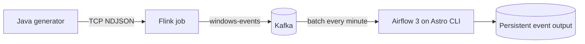

# Kafka event pipeline with Flink and Astro Airflow

This is the combined runnable home of `mwaa-kafka-project` and
`tcp_flink_kafka_connector`. Java generates events, Flink sends them to Kafka,
and an Astro-managed Airflow DAG consumes finite batches into persistent SQLite.
The sibling repository's launch scripts delegate here. Everything runs locally
using Podman; no AWS or Astro Cloud account is required.

## Repository consolidation

**This repository is the source of truth for the complete pipeline.** The Java
streaming components from
[`tcp_flink_kafka_connector`](https://github.com/vikramaditya-tatke/tcp_flink_kafka_connector)
are included here as source; that repository is no longer needed to build or run
the pipeline.

| Component | Maintained location | Responsibility |
| --- | --- | --- |
| TCP event producer | `streaming/producer/` | Generate newline-delimited JSON events |
| Flink application | `streaming/flink/` | Read TCP events and publish them to Kafka |
| Kafka and streaming containers | `compose.yaml`, `containers/` | Run the producer, broker and Flink cluster on Podman |
| Airflow consumer | `dags/` | Consume bounded Kafka batches into durable output |
| Astro environment | `.astro/`, `Dockerfile`, `docker-compose.override.yml` | Run Airflow 3 locally and connect it to Kafka |
| Launcher and verification | `scripts/`, `include/`, `tests/` | Start, stop and verify the complete pipeline |

The original streaming repository retains its history and compatibility launch
scripts. Those scripts require both checkouts to be siblings; new development
belongs in this repository. The previous TCP-to-Kafka Airflow producer DAG has
been replaced by the Kafka consumer DAG `kafka_event_pipeline`.



## Start

Clone only the combined repository:

```bash
git clone https://github.com/vikramaditya-tatke/mwaa-kafka-project.git
cd mwaa-kafka-project
```

Install Podman, a Compose provider (`podman compose version`), and
[Astro CLI](https://www.astronomer.io/docs/astro/cli/install-cli/).
The setup was verified with Astro CLI 1.46.1 and Podman 5.8.6.
Allow about 6 GB RAM and internet access for initial image pulls.

On Linux, enable Podman's API socket before starting:

```bash
systemctl --user start podman.socket
./scripts/pipeline.sh up
./scripts/pipeline.sh status
./scripts/pipeline.sh verify
```

On a host without systemd, keep `podman system service --time=0` running instead.
The launcher starts the Java generator, Kafka, and Flink using Podman Compose,
creates the persistent event volume, then runs `astro dev start`.
Astro manages its own PostgreSQL, database migration, scheduler, API server,
DAG processor and triggerer. Flink submits the TCP-to-Kafka application
without a separate manual submission step.

- Airflow UI: <http://localhost:8080> — Astro's local development mode requires no login
- Flink UI: <http://localhost:8081>
- Kafka: host `localhost:29092`; container network `kafka:9092`
- DAG: `kafka_event_pipeline`; task: `consume_events`; schedule: every minute

Airflow, PostgreSQL and streaming ports published by this project bind to loopback.
Copy `.env.example` to `.env` to configure the topic, generation rate or streaming
ports. To change Astro's API port, run `./scripts/astro.sh config set api-server.port 8082`.

## Astro workflow

The root `Dockerfile` pins
`astrocrpublic.azurecr.io/runtime:3.3-10-python-3.12`: the current stable Runtime
for Airflow **3.3.2** as checked on 23 October 2026. The installed distribution
reports `3.3.2+astro.2`; Python is 3.12.15. The Python 3.12 image keeps the existing
Kafka client compatible while using the latest stable Airflow release.
See [Runtime release notes](https://www.astronomer.io/docs/runtime/runtime-release-notes/).

Use the project wrapper for Astro commands on native Linux Podman:

```bash
./scripts/astro.sh dev run version
./scripts/astro.sh dev logs --scheduler
./scripts/astro.sh dev logs --dag-processor
./scripts/astro.sh dev pytest
./scripts/astro.sh dev restart --no-proxy
```

`astro.sh` sets `DOCKER_HOST` to the native rootless Podman socket when it is not
already set. This tells Astro to use the existing Linux engine. It avoids
Astro's otherwise automatic Podman VM setup. The project config explicitly
selects Podman. For direct CLI use, set the same environment once:

```bash
export DOCKER_HOST="unix://${XDG_RUNTIME_DIR:-/run/user/$(id -u)}/podman/podman.sock"
astro dev start --no-browser --no-proxy
```

Start the streaming infrastructure first when using `astro dev start` directly;
`./scripts/pipeline.sh up` handles the required order and volume creation.
Airflow discovers edits to `dags/` and `include/` through bind mounts. Restart
Astro after changing `requirements.txt`, `packages.txt`, `Dockerfile`, or its
Compose override. Rerun `pipeline.sh up` after Java/Flink source changes.

`compose.yaml` owns streaming services only. `docker-compose.override.yml`
connects Astro's components to the streaming network and mounts the shared
`kafka-airflow_event_data` volume. Airflow 3 DAGs use the Task SDK and the standard
Python operator. Integration verification uses the public REST API, including
DAG triggering, task state and XCom retrieval; it never queries Airflow metadata
SQL directly.

## Output and verification

`./scripts/pipeline.sh verify` triggers an actual scheduler-run DAG, requires 30
fresh events from the Java source, checks durable output and broker-committed
offsets, then replays records through independent consumer groups. A second
replay must insert zero duplicate rows. It also checks Airflow component health,
DAG import errors, a RUNNING Flink job and SQLite integrity.

Output stays in the `kafka-airflow_event_data` named volume. Inside the Astro
scheduler it is available at `/usr/local/airflow/data/events.db`; the latest
report is `/usr/local/airflow/data/verification.json`. Export the report with:

```bash
mkdir -p artifacts
scheduler_id="$(python3 scripts/astro_container.py scheduler)"
podman cp "${scheduler_id}:/usr/local/airflow/data/verification.json" artifacts/verification.json
```

See [recorded verification](docs/VERIFICATION.md). Reports and the previous
Airflow 2 metadata backup are local ignored files under `artifacts/`.

## Stop and resume

```bash
./scripts/pipeline.sh down
./scripts/pipeline.sh up
```

`down` stops Astro and the streaming containers while preserving named volumes.
Do not use `astro dev kill` for normal shutdown: that command removes Astro's
local environment data. Kafka history and consumer offsets must stay paired
with their event output. If replacing a topic's history, use a new topic and
output destination so `(topic, partition, offset)` identities cannot collide.

## Processing and failure behavior

The TCP producer runs in its own Java 17 container and listens on
`producer:9999` inside the streaming network. Flink connects to that address;
the TCP port is not published to the host. Each connection receives one JSON
event per `EVENT_INTERVAL_MS` interval (100 ms by default). Events include
Windows log fields, a unique `eventUid` and a `pipelineRun` marker for the
generator process. A TCP health check verifies that the producer emits a record.

Airflow consumes up to 1,000 records or 20 seconds per run, with one active DAG
run. The generator defaults to around ten events per second per TCP connection.
If changing the rate, adjust batch size and schedule together to avoid lag.

The consumer disables automatic commits and automatic offset storage. It
validates records, persists the batch, then synchronously commits explicit next
offsets. Validation, broker/topic, or output errors fail the task. Retrying after
an uncertain commit is safe because the output deduplicates by topic, partition
and offset. Malformed events block their batch for investigation.

These guarantees begin at Kafka. The synthetic TCP source has no replay log, so
in-flight events before Kafka can be lost during a producer/Flink failure. This
is a single-broker development stack; Kafka retention defaults to 24 hours.

## Source and tests

- `streaming/`: imported Java producer and Flink source, matching pinned Flink runtime
- `dags/`: Airflow 3 DAG, schema validation, bounded consumer and durable sinks
- `.astro/config.yaml`, `Dockerfile`, `requirements.txt`, `packages.txt`: Astro project
- `include/container_verify.py`: Airflow 3 API integration verifier
- `scripts/`: combined launcher, Astro socket wrapper and container lookup
- `tests/`: failure handling, commit ordering, schema validation and replay tests

```bash
./scripts/astro.sh dev pytest
uv run --no-project --with pytest --with ruff python -m pytest tests -q
uv run --no-project --with pytest --with ruff ruff check dags scripts include tests
```

AWS discovery was read-only. Cloud deployment is out of scope for the selected
local setup; no AWS resource was created or changed.
