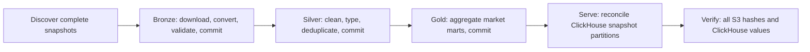

# Airbnb analytics on shared Airflow

This repository owns two independent workloads in one Astro Airflow environment:
`kafka_event_pipeline` consumes Kafka every minute; `airbnb_analytics` processes
Inside Airbnb snapshots on demand. Airbnb data does not pass through Kafka.
The original Airbnb repository remains an unchanged historical reference,
including its CLI. This combined repository has no ingestion CLI or Python
module entry point: data processing is triggered and retried through Airflow.
The shell scripts manage infrastructure and verification only.

## 1. Start infrastructure and configure connections

Run `./scripts/pipeline.sh up` from the repository root. The launcher creates a
random local ClickHouse password in ignored `.env` when absent, starts the
streaming services and dedicated `airbnb-clickhouse` service, starts Astro, and
creates the two-slot `airbnb_batch` pool through Airflow's public API.
Global parallelism is four; Airbnb permits two tasks and one active run.
The existing Kafka, Airflow metadata/log, and SQLite volumes retain their names.
The dedicated ClickHouse volume is `kafka-airflow_airbnb_clickhouse_data`.
No ClickHouse host port is published; other local ClickHouse projects are independent.

The default bucket already exists: **airbnb-analytics-bucket-v2**, **eu-west-2**.
Bucket ownership, region, and object permissions are checked at runtime. A new
environment must provision its bucket before triggering analytics. Dataset tasks
do not silently create infrastructure or change IAM permissions.

| Connection | Purpose | Local default |
| --- | --- | --- |
| `aws_airbnb` | Amazon provider S3/STS credentials | Empty AWS connection uses the worker's role/credential chain |
| `duckdb_default` | Official Apache DuckDB provider | Optional; task-scoped in-memory database with 512 MB limit and two threads |
| `clickhouse_airbnb` | ClickHouse HTTP client | Dedicated service, database `airbnb_analytics`, user `airbnb` |

The environment helper writes connection JSON to ignored `.aws/airflow.env`
with owner-only host permissions. Compose injects it into every Airflow
component; it is excluded from Git and container image build contexts.
Override `AIRFLOW_CONN_AWS_AIRBNB` in the launch environment for a supplied
Airflow AWS connection. In deployed environments, use an IAM role or secrets
backend instead of committing credentials.

For local SSO, set `AIRBNB_AWS_PROFILE=your-profile` in `.env`, refresh that
profile with your normal AWS SSO sign-in, then run the launcher. The helper
exports temporary credentials without printing them. These credentials retain
their AWS expiration; refresh SSO and restart Astro before another run after
they expire. It does not mount the host's SSO cache or embed credentials into
images. Kafka-only operation needs no AWS account or credentials.

## 2. Trigger a selected snapshot

Open Airflow at `http://localhost:8080` (or your configured Astro port), unpause
`airbnb_analytics`, and choose **Trigger DAG**. Defaults process Albany.

```json
{
  "cities": ["albany", "pacific-grove"],
  "snapshots": [],
  "bronze_engine": "duckdb"
}
```

`cities` selects configured city slugs; `snapshots` selects ISO source snapshot
dates, with an empty list selecting configured dates for those cities.
`bronze_engine` accepts `duckdb` or `polars`. Unknown selections, incomplete
three-table snapshots, source HTTP errors, or invalid data fail the run visibly.
The historical catalog contains inaccessible URLs; no task treats HTTP 403 as a
successful skip. `include/config/airbnb/ingestion.toml` sets storage/resource
defaults; `AIRBNB_INGESTION_CONFIG` can point to another config on every worker.

Each discovered city/date maps to this task group:



Tasks own their temporary files and clean them on normal completion. XCom holds
object references and results, never local paths or dataset rows. Each stage
resumes independently after a failure; clear/retry the failed task in Airflow.

## 3. Understand the data contracts

**Bronze** preserves every CSV field as a nullable string in ZSTD Parquet. IDs,
required dates, schemas, compression, row counts, and hashes are validated
before publication. Both converters share `raw-strings-v1` identities and reuse
the original bucket's existing completions. DuckDB conversion and validation
always obtain connections from `airflow.providers.duckdb.hooks.duckdb.DuckDBHook`.
Polars is an alternate bronze converter; silver and gold use the DuckDB provider.
No runtime DuckDB extension installation or direct DuckDB S3 writes are needed.

**Silver** retains source city/date, uses signed 64-bit IDs, decimal money and
ratings, actual dates, and nullable availability booleans. Missing optional
columns are represented by nulls. Missing/invalid prices stay unknown; negative
prices are excluded. Prices use the source's decimal-point/comma-grouping format.
Listings deduplicate by ID, latest scrape date, then a stable source-row hash;
calendar deduplicates listing/date; reviews deduplicate review ID with the same
stable tie rule and exclude blank/whitespace comments. Equal review text with
different IDs remains distinct. Price quintiles use non-null snapshot prices;
ties can leave some buckets empty. There are no placeholder sentiment scores.

**Gold** produces these S3 and ClickHouse marts:

| Mart / ClickHouse table | Grain beyond city, source snapshot, currency | Measures |
| --- | --- | --- |
| `market_summary` / `market_summary_v1` | Neighbourhood, room type | Listings, hosts, priced/rated listings, mean/median asking price, mean rating |
| `calendar_monthly` / `calendar_monthly_v1` | Neighbourhood, room type, calendar month | Advertised available/unavailable/unknown days, known-day availability rate, mean asking price, unmatched listing days |
| `review_monthly` / `review_monthly_v1` | Neighbourhood, room type, review month | Nonblank reviews, reviewed listings, mean comment length, unmatched listing reviews |

Gold joins deduplicated snapshot tables, so reviews and calendar rows cannot
multiply through duplicate listings. Unmatched listing IDs remain visible under
`unknown` dimensions and explicit counts. Aggregation never combines currencies;
the source country determines its documented local currency code (Hong Kong uses HKD), and unknown
countries require an explicit mapping. No FX conversion is performed. Advertised
unavailability is not evidence of a booking; these marts do not claim actual
occupancy, revenue, or sentiment.

## 4. Storage, retries, and model revisions

```text
bronze/city=albany/snapshot_date=2025-08-04/listings.parquet
_manifests/bronze/city=albany/snapshot_date=2025-08-04/listings.json
silver/v1/model=<revision>/city=albany/snapshot_date=2025-08-04/listings.parquet
gold/v1/model=<revision>/city=albany/snapshot_date=2025-08-04/market_summary.parquet
_manifests/silver/.../listings.json
_manifests/gold/.../market_summary.json
```

S3 conditional writes (`IfNoneMatch=*`, including multipart completion) publish
immutable payloads, then separate completion manifests. A committed rerun skips
source downloads and writes. A crash after payload publication recovers the
manifest from validated metadata. A changed/missing committed object or conflicting
lineage raises an error; no task overwrites it. Derived manifests include exact
parent object versions/hashes. SQL and transformation source hashes select a new
model path on a revision, preserving older S3 results. Bucket versioning remains
enabled; data is not automatically expired.

ClickHouse receives complete gold artifacts in per-attempt staging tables.
Staging values must match Parquet before `REPLACE PARTITION` publishes the
city/snapshot atomically within each mart. A retry compares all target values
first and skips matching data; it never appends duplicate served rows. A new
model revision replaces only the selected snapshot's serving partition. The
three marts are separate commits; consult a successful `snapshot.verify` result
for whole-snapshot completion. A hard worker kill can leave an unreferenced
`_stage_*` table; retries use fresh names, and operators can remove abandoned stages.

Gold schema changes require an explicit serving-table migration or a new table
version; model revision paths do not silently alter existing ClickHouse schemas.

The query-driven order key starts with city/snapshot, then neighbourhood/room
type and month where applicable. Per `schema-pk-plan-before-creation` and
`schema-types-native-types`, keys and native types match the reporting grains.
Per `insert-batch-size`, a complete aggregate artifact is one insert, avoiding
row-at-a-time publication. Per `schema-partition-lifecycle`, partitions support
snapshot replacement. Monitor partition counts as history grows; this deliberately
bounded local design is not an unlimited global warehouse.

## 5. Verify and inspect results

`./scripts/pipeline.sh verify` checks the existing streaming path. The Airbnb
verification helper triggers two real scheduler runs through the public REST
API, first with DuckDB, then Polars. It verifies successful mapped tasks,
downloads and hashes all nine artifacts per snapshot, compares every served
gold value, and asserts no S3 versions or ClickHouse duplicates on rerun.

Run the Airbnb verifier in the scheduler container:

```bash
podman exec "$(python3 scripts/astro_container.py scheduler)" \
  python /usr/local/airflow/include/airbnb_verify.py
```

Its default smoke cities are Albany and Pacific Grove; set `AIRBNB_VERIFY_CITIES`
to a JSON array in the verifier environment to choose others. Persistent evidence
is written to `/usr/local/airflow/data/airbnb-verification.json`; individual
Airflow task results include counts and outcomes. This helper runs no data
transformation itself. Query ClickHouse through its client inside the dedicated
service or a configured connection; filter by city/snapshot to choose a reporting
cohort and keep currency in aggregate groupings.

```sql
SELECT city, snapshot_date, currency_code, sum(listing_count) AS listings
FROM airbnb_analytics.market_summary_v1
WHERE city = 'albany'
GROUP BY city, snapshot_date, currency_code;
```

For local development, `uv sync --extra dev` installs the test dependencies.
Run `uv run pytest -q`; fixtures exercise real provider connections and Parquet
against isolated Moto S3. These tests never modify the live bucket. Moto cannot
evaluate the TLS-only bucket policy, so fixtures remove that policy only in the
emulator; bootstrap policy contents are asserted separately.
